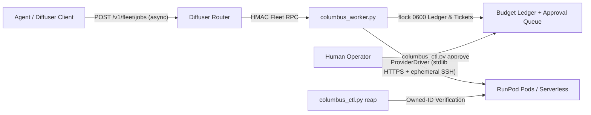

<p align="center"></p>

# Columbus

### Elastic cloud GPUs. Human-gated spend.

[](LICENSE) [](#quickstart) [](AUDIT.md)


**Columbus is an official approval-gated, budget-bounded on-demand cloud GPU adapter for [Diffuser](https://github.com/Gavinbombay/Diffuser).**

[For AI agents](#for-ai-agents) · [Architecture](#architecture) · [Quickstart](#quickstart) · [Security notes](docs/SECURITY.md) · [Security audit](AUDIT.md)

## Features

- **Mandatory human approval gate**: Every billable job stages a `pending_approval` ticket bound to the canonical SHA-256 of the job spec. No cloud pod or serverless job starts until the owner runs `columbus_ctl.py approve <ticket_id>`.
- **Zero-dependency Python stdlib driver**: Pluggable `ProviderDriver` interface shipping a stdlib-only **RunPod** driver (GraphQL Pods with ephemeral per-job `ed25519` SSH execution, plus REST v2 Serverless).
- **Hard spend & custody guardrails**: Cumulative USD budget ledger with `flock`-serialized atomic `0600` reservations, live balance floor checks, and per-job `max_usd` caps.
- **Race-free credential handling**: Per-job API key loading uses `O_NOFOLLOW` + `fstat` `0600` checks so keys rotate without restarting the worker.
- **Owned-only teardown & orphan reaper**: Resource tagging (`diffuser-columbus-<lane>-<nonce>-g<n>`), provider-ID-bound teardown with absence verification, lane quarantine on ambiguous cleanup, and automated `columbus_ctl.py reap`.

## For AI agents

Columbus plugs into Diffuser's standard `/v1/fleet/jobs` contract. Enroll `columbus_worker.py` as an `exec` profile advertising `columbus.runpod.pod.exec/v1` and `columbus.runpod.serverless.exec/v1`:

| Action | Description | Billable |
|---|---|---|
| `status` | Inspect live balance, owned pods, and remaining USD ledger budget | No |
| `estimate` | Compute cost ceiling and check balance floor before staging | No |
| `stage` | Create a single-use `pending_approval` ticket bound to spec SHA-256 | No |
| `exec` | Execute an owner-approved ticket with bounded artifact return and guaranteed teardown | Yes (approved only) |

## Architecture



## Quickstart

```sh
# 1. Store your RunPod API key outside the repository (0600)
install -d -m 700 ~/.config/columbus
umask 077 && printf "%s\n" "<YOUR_RUNPOD_API_KEY>" > ~/.config/columbus/runpod_api_key

# 2. Run the 32 offline deterministic unit tests (zero network calls)
python3 -B -m unittest discover -s tests -v

# 3. Inspect balance, owned pods, and budget ledger (read-only)
./columbus_ctl.py status

# 4. Approve a staged agent job ticket
./columbus_ctl.py tickets --status pending_approval
./columbus_ctl.py approve <ticket_id>
```

## Security notes

Columbus enforces fail-closed approval, bounded HTTP/JSON/SSH artifact reads, ephemeral per-job SSH keys cleaned inside `try/finally`, and lane quarantine on ambiguous provider teardown. See [DESIGN.md](DESIGN.md), [AUDIT.md](AUDIT.md), and [docs/SECURITY.md](docs/SECURITY.md).

## License

Apache License 2.0. See [LICENSE](LICENSE) and [NOTICE](NOTICE).
